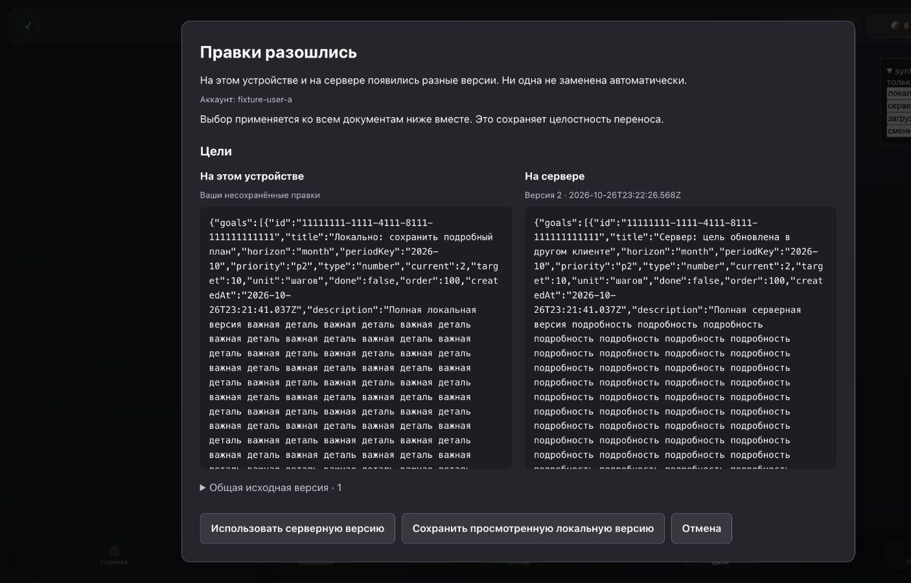
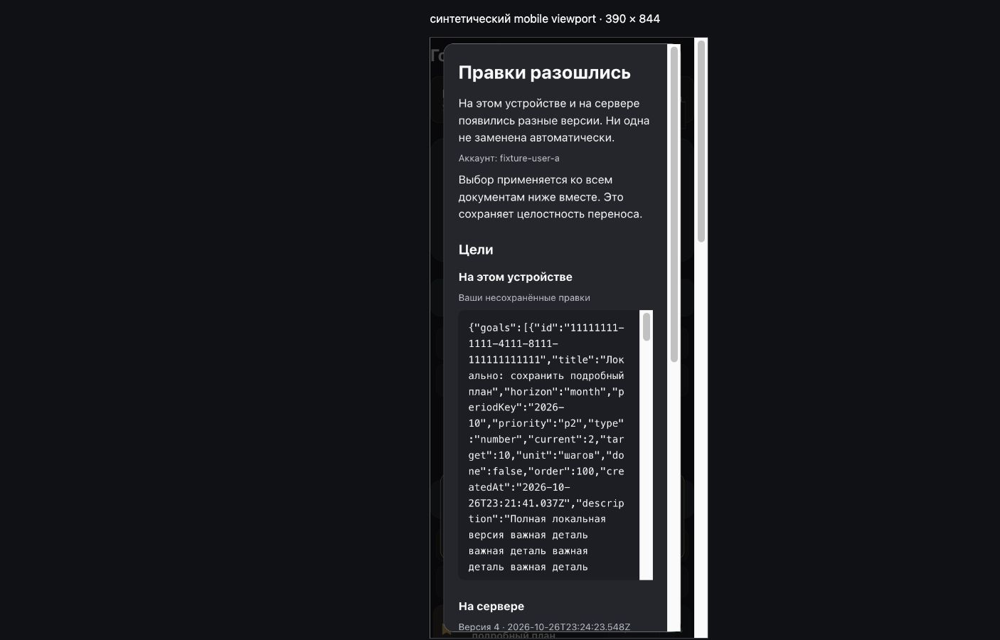
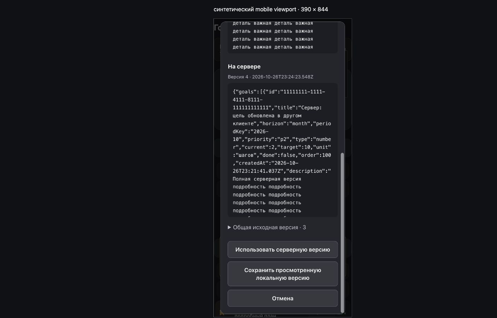

# выполнение плана подтверждаемой записи через hermes

статус: реализация начата пользователем, production и writer не включены. это журнал разработки, не акт live acceptance.

## основа

- утверждённые дизайн/план находятся в `docs/superpowers/specs/2026-10-27-hermes-dashboard-write-design.md` и `docs/superpowers/plans/2026-10-27-hermes-dashboard-write.md`;
- прямая зависимость: pr #70, head `cc74d37acfca58c610b257176ec6ffbc8bd82cde`, на начало работы open;
- issue: [защита от потери правок #71](https://github.com/quazarsdaw/my-dashboard/issues/71);
- отдельная ветка первого pr: `feature/hermes-dashboard-versioned-sync`;
- исходная проверка: frontend 537/537, school 108/108, reader 14/14, python reader 10/10, check/lint обеих edge functions прошли.

## задача 1: postgres cas

- штатная cli `supabase@2.122.0` создала `20261026221536_dashboard_document_versions.sql`; имя не придумывалось/не переименовывалось;
- исходные миграции не изменены; только изолированные synthetic базы применяют их с нуля, production history не менялась;
- red: 18 postgres tests выполнялись на настоящей временной базе и падали на отсутствующих rpc/versions;
- green: 18/18 на локальном postgres 18.4, включая stale update, конкурентный first insert, move, rollback, tombstone, owner/anon isolation, guard, неизменность text и строковые bigint revisions;
- добавлена ci-проверка postgres 17/pgTAP с фиксированными официальными image/action digests. она пока не запускалась: отсутствие запуска не считается green;
- guard/write по умолчанию false; capability rpc не даёт браузеру права включить flags;
- shared-memory startup требовал разрешения вне sandbox; использовались только временный cluster, unix socket и synthetic данные, не production.

## задача 2: версии и устойчивые ссылки в reader

- добавлены source revision и entity expectedRevision без javascript number, id задачи и snapshot-bound reference legacy цели;
- пять read tools, root envelope и auth scope не менялись; python reader не изменён;
- edge читает фиксированный `dashboard_read_agent_documents`, проверяет полноту массива, версии, missing/tombstone и возвращает только прежнюю проекцию с новой metadata;
- red: 11 pass / 5 fail на недостающих полях и старом transport; green: reader 16/16, check/lint pass, python reader 10/10;
- обновлённый reader не опубликован: production продолжает использовать прежний код до отдельного согласованного deployment после миграции.

## ещё не выполнено

задачи 6–11 и три pr. независимое ревью pr 1 завершено; после fix pass требуется финальный повтор browser acceptance перед открытием первого pr. production schema/history/advisors и реальный telegram проверяются перед отдельным разрешённым deployment/activation, не подменяются локальными результатами.

## задача 3: локальная база, dirty и отправленный снимок

- чистый reducer и adapter сохраняют owner-scoped pending; late ack/realtime/reload не заменяют следующую правку; v2 не использует клиентские часы для защищённых keys;
- fallback разрешён только при точно отсутствующей capability rpc; auth/network ошибка не включает legacy upsert;
- новые browser rpc дополнительно принимают `p_expected_owner` и сравнивают его с `auth.uid()` до чтения/записи. это предусловие против смены jwt, не право указать чужого владельца; модель hermes его не получает. уточнение плана прошло regression-first;
- конфликт одного документа блокирует целый отправляемый batch, чтобы не отправилась половина переноса; ui задачи 5 должен разрешать такую группу целиком;
- core/adapter 29/29, postgres 20/20 на локальном pg18. ui и реальные telegram пока не проверены.

## задача 4: id и привязка редакторов

- новые задачи и цели получают uuid v4; браузер без crypto не создаёт timestamp-id. старые id сохраняются, массовой выдачи id legacy записям нет;
- modal, inline title, sphere picker, подтверждение выполнения, delete и drag задач связаны с целевой записью и снимком. цели проверяют stale editor, drag и открытый перенос; дубли id не выбираются первым совпадением;
- проверка удаления повторяется после native confirm. собственный ack с тем же документом не делает редактор устаревшим, но смена owner/содержимого/conflict отменяет сохранение;
- ручной перенос сохраняет описание, подзадачи, id и дополнительные поля; одинаковое название другой задачи больше не удаляет источник. rollover создаёт настоящую копию с новым uuid и сохраняет архив;
- проверены формы, готовое распознавание скриншота без вызова модели, inbox → задача/цель. входящие используют явные period/priority и активный день с границей 06:00;
- хрупкая source-text проверка порядка награды заменена запуском настоящего ui handler: local → reward → cloud сохраняется; stale handler не начисляет награду соседу;
- промежуточный полный frontend 578/578; окончательный результат блока записан в execution ledger после дополнительной проверки native confirm/offline uuid.

## ci: что реально выполнялось

- run `40414663465`: контейнер не создался из-за single quotes в healthcheck; исправлено `fe3a7d0`;
- run `40415574977`: cas 20/20 на pg17, затем pgTAP не нашёл функцию в закрытой extensions schema. тестовый bootstrap дополнен schema usage/legacy auth claim и отдельной проверкой 21/21 локально, коммит `aa931f7`;
- run `40417079622`: cas 21/21 на pg17; старый `user_data_rls.sql` упал на вложенном data-modifying cte. полный ci пока не green; это не failure cas-транзакций и не доказательство production состояния.
- issue #72: modifying cte вынесены на верхний уровень без изменения assertions. новый identity trigger сохраняет код отказа `42501`, как прежняя rls; regression сначала показал `22023`, затем локальные postgres tests прошли 22/22. повторный pg17/pgTAP ci обязателен.
- run `40418259177`, head `e7a8656`: success, cas 22/22 на pg17 и существующие pgTAP проверки. следующий head должен повторно пройти ci перед открытием pr.

## задача 5: видимый конфликт, безопасный импорт и synthetic ui

- на всех 13 страницах единый набор `409-cas`: core и conflict ui загружаются раньше sync, отдельный goals-core `v=3`;
- немодальное уведомление не мешает редактору; явный native dialog показывает полные исходные тексты обеих версий и общий base, безопасно через text nodes. длинный текст прокручивается без обрезания; мобильный dialog открывается с заголовка, а не автоматически внизу;
- review token включает owner и версии/локальные эпохи всех документов группы. перед выбором повторный pull; новый remote/local/account отменяет старый выбор. группы переноса выбираются целиком; local choice проходит тот же atomic cas;
- escape/отмена не пишут. смена аккаунта закрывает и выполняющийся dialog; late result не открывает его снова;
- v2 массовый сброс блокируется; профиль после отказа не предлагает local clear, не удаляет pending/auth/metadata. backup импортирует только app values, а не revisions, sync state или tokens;
- первое пустое открытие целей больше не пишет выдуманную локальную версию до pull: реальный browser fixture выявил проблему, regression показал лишнюю запись, затем исправление прошло green;
- loopback fixture на двух портах использует только synthetic данные и sdk, закрытый набор rpc, csp `connect-src 'self'`. production html не имеет bypass-флагов; repo/config/test файлы сервер не отдаёт;
- browser acceptance: desktop и 390×844 iframe viewport (не физическое мобильное устройство), два изолированных origin-клиента одного synthetic владельца, offline/reload, новый remote, stale editor с сохранённым текстом формы, escape, смена аккаунта/возврат, явный local choice;
- frontend 596/596, reader 16/16 и school 108/108, обе edge check/lint pass. итоговый повтор с postgres/python записывается в execution ledger.

## независимое ревью pr 1 и одна fix pass

ревью exact `11b6d8b` нашло четыре important, critical не подтверждены. все приняты; воспроизведения записаны в [issue #71](https://github.com/quazarsdaw/my-dashboard/issues/71#issuecomment-6429955014) до исправлений.

1. перенос из уже конфликтующего source больше не отправляет destination отдельно. touched conflict объединяет сохранённую группу с новым pending batch; late storage event не объявляет source независимым. действительно независимый новый документ по-прежнему сохраняется отдельно.
2. правки после logout перед сменой аккаунта сохраняются в cache прежнего отображаемого владельца. новый аккаунт их не получает; возврат восстанавливает pending.
3. неизвестный сетевой исход local choice возвращает группу в доступный review. ui предлагает актуальные версии и новый явный click, без автоматического retry. совпавший destination остаётся cas предусловием и не выпадает из переноса.
4. inline-текст не пропадает при sync rerender: отдельный owner/document/target-bound draft показывает полный текст для копирования, без автоматического применения к обновлённой записи. повторный rerender и возврат владельца покрыты отдельно. это in-memory draft формы, не гарантия пережить закрытие вкладки.

все пути сначала подтверждены red, затем green; полный frontend 604/604. новые файлы отформатированы без переписывания существующих html. reader 16/16, school 108/108, обе edge check/lint, python reader 10/10 и local postgres 22/22 повторно прошли. дополнительно моделируется настоящий blur при удалении dom: автоматический rerender сохраняет draft без блокирующего alert и повторной записи. final head должен повторить ci.

скриншоты выше — выполненная проверка `11b6d8b`. повтор браузерного acceptance fix pass пока не завершён: временная вкладка перестала принимать ввод, затем ни semantic, ни native/coordinate click в чистой вкладке не раскрыли обычный fixture `
`. readonly dom/screenshot продолжают отвечать. requested user recovery ограничен закрытием synthetic вкладок `127.0.0.1:63591/63592`; production или исходная вкладка пользователя не затрагиваются. это не объявляется успешной ui-проверкой последнего head.
